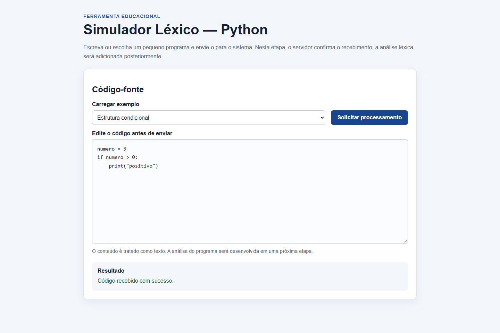

# Simulador Léxico — Python

Aplicação educacional para apoiar o estudo de compiladores. Nesta segunda etapa, o sistema permite escrever ou escolher um pequeno programa em Python e enviá-lo à API. **O código ainda não é analisado**: o backend somente valida o recebimento. A análise léxica e outras fases serão desenvolvidas nas próximas etapas.

## Escopo planejado

O projeto pretende reconhecer um subconjunto de Python:

- Identificadores.
- Palavras reservadas: `if`, `else`, `while`, `print`, `def`.
- Operadores: `=`, `+`, `-`, `*`, `/`, `==`, `<`, `>`.
- Delimitadores: `(`, `)`, `:`, `,`.
- Literais: números inteiros e strings entre aspas duplas.

Essas construções descrevem o escopo futuro do analisador e não implicam que a análise já esteja implementada.

## Tecnologias

- Frontend: HTML, CSS e JavaScript, servido pelo Nginx.
- Backend: API REST em Python com Flask.
- Execução: Docker Compose.
- Testes: `unittest` para a API e Playwright para os fluxos da interface no navegador.

## Executar a aplicação

Requisitos: Docker com Docker Compose.

Na raiz do repositório:

```sh
docker compose up --build -d --wait
```

Acesse a interface em <http://localhost:8080>. A API também é publicada em `http://localhost:5000`; a interface usa `/api/` pelo proxy reverso do Nginx, encaminhado ao serviço Flask dentro da rede Docker.

Para encerrar:

```sh
docker compose down
```

## Usar a interface

1. Digite ou cole código na área de texto, ou carregue um exemplo.
2. Edite o código como desejar.
3. Selecione **Solicitar processamento**.
4. Veja a confirmação ou a mensagem de validação na área **Resultado**.

Exemplos disponíveis:

| Exemplo | Construções demonstradas | Código inicial |
| --- | --- | --- |
| Variável e saída | Identificador, atribuição, inteiro e `print` | `numero = 10` e `print(numero)` |
| Operação aritmética | Atribuição, identificador, inteiros e `+` | `resultado = 10 + 5` e `print(resultado)` |
| Estrutura condicional | `if`, comparação, delimitadores e string | Inicializa `numero` e testa se é maior que zero para imprimir `"positivo"` |

O seletor carrega o exemplo no editor; o conteúdo permanece editável antes do envio.

## Demonstração

Captura da interface após carregar um exemplo e receber a confirmação da API:



## API

### `POST /api/analisar`

Recebe JSON:

```json
{
  "codigo": "numero = 10"
}
```

Com conteúdo não vazio, responde HTTP `200`:

```json
{
  "mensagem": "Código recebido com sucesso.",
  "recebido": true
}
```

Não são produzidos tokens nem feita análise do programa nesta etapa. A API rejeita conteúdo não JSON (HTTP `415`), corpo inválido, campo ausente ou campo que não seja texto (HTTP `400`), e código vazio ou composto apenas por espaços (HTTP `400`). Falhas inesperadas retornam uma mensagem genérica (HTTP `500`). A rota existente `GET /api/hello` permanece disponível.

## Testes

Os testes da API usam `unittest`. Instale as dependências Python e execute na raiz:

```sh
python -m pip install -r backend/requirements.txt
python -m unittest discover -s backend/tests -v
```

Os testes de interface usam Playwright e precisam da aplicação executando pelo Docker Compose. Na pasta `frontend`:

```sh
npm ci
npx playwright install chromium
npm test
```

Os testes de navegador cobrem a identificação da interface, carregamento/troca/edição de exemplos, validação de entrada, envio e confirmação da API, tratamento de erro de validação, falha de comunicação e erro inesperado. A rota `/api/hello` é verificada nos testes da API.

### Resultados desta etapa

- Testes da API: 7 aprovados.
- Testes de navegador: 6 aprovados.
- Docker Compose: imagens construídas e serviços iniciados; backend saudável e interface acessível.

## Limitações desta versão

- O backend apenas confirma o recebimento; não tokeniza nem valida a sintaxe ou semântica do código.
- Ainda não há realce de sintaxe, execução do código ou editor avançado.
- O escopo da linguagem é planejado e será implementado progressivamente.
