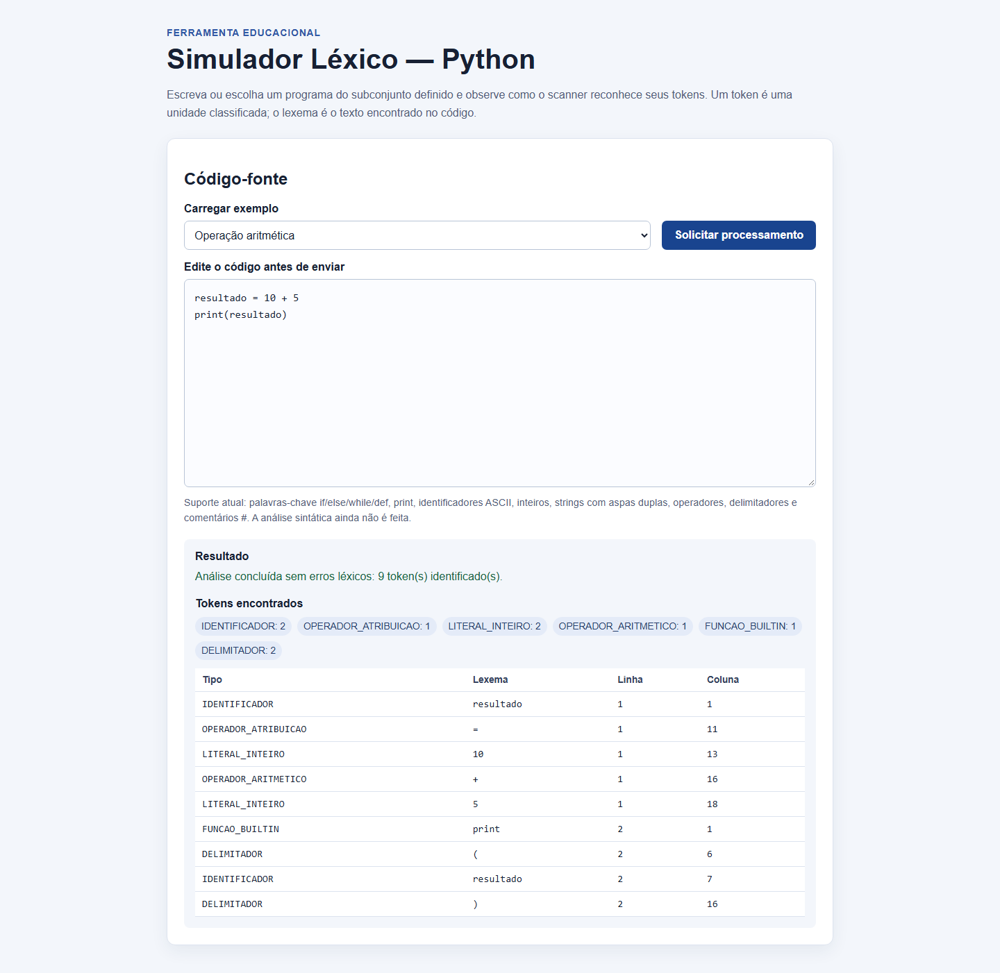

# Simulador Léxico — Python

Aplicação educacional para demonstrar a análise léxica de um subconjunto de Python. O scanner lê o código, reconhece lexemas e informa a categoria e a posição dos tokens. **Ele não valida a sintaxe nem executa o programa.**

## Subconjunto reconhecido

| Categoria | Regra ou exemplos |
| --- | --- |
| Palavras-chave | `if`, `else`, `while`, `def` |
| Função embutida | `print` (`FUNCAO_BUILTIN`; em Python, `print` não é palavra reservada) |
| Identificadores | `[A-Za-z_][A-Za-z0-9_]*`, com distinção entre maiúsculas e minúsculas |
| Inteiros | Dígitos decimais, como `0`, `10`, `42`; `-` é token separado |
| Strings | Aspas duplas; escapes `\"` e `\\` |
| Operadores | Atribuição `=`, aritméticos `+`, `-`, `*`, `/`, comparação `==`, `<`, `>` |
| Delimitadores | `(`, `)`, `:`, `,` |
| Comentários | Comentários de linha iniciados por `#`, ignorados pelo scanner |
| Espaços em branco | Ignorados; posições de tokens são 1-based. Tab conta como uma coluna. |
| Caracteres/sequências fora do recorte | Geram erros léxicos com lexema, linha, coluna e mensagem; o scanner continua quando possível. |

O scanner é implementado manualmente, percorrendo os caracteres, sem dependências adicionais. O operador `==` é reconhecido antes de `=`. As categorias de token incluem `PALAVRA_RESERVADA`, `FUNCAO_BUILTIN`, `IDENTIFICADOR`, `LITERAL_INTEIRO`, `LITERAL_STRING`, categorias de operadores e `DELIMITADOR`.

### Limitações intencionais

Este recorte não implementa Python completo. Números reais, strings entre aspas simples, escapes além de `\"` e `\\`, identificadores Unicode e operadores fora da tabela não são reconhecidos. A indentação não gera tokens `INDENT`/`DEDENT`. Comentários de bloco não são suportados. A análise sintática (incluindo estrutura de blocos e validade das expressões), semântica e execução do código ficam para etapas posteriores.

## Tecnologias

- Frontend: HTML, CSS e JavaScript, servido pelo Nginx.
- Backend: API REST em Python com Flask.
- Execução: Docker Compose.
- Testes: `unittest` para scanner/API e Playwright para a interface.

## Executar

Requisitos: Docker com Docker Compose.

Na raiz do repositório:

```sh
docker compose up --build -d --wait
```

Acesse <http://localhost:8080>, escolha ou digite um exemplo e selecione **Solicitar processamento**. A tabela mostra tipo, lexema, linha e coluna; abaixo dela aparece a contagem por categoria. Erros léxicos são listados separadamente. A análise ainda não verifica se o programa é sintaticamente válido.

Para encerrar:

```sh
docker compose down
```

## Exemplos da interface

| Exemplo | Construções demonstradas | Código |
| --- | --- | --- |
| Variável e saída | Identificador, atribuição, inteiro e `print` | `numero = 10` e `print(numero)` |
| Operação aritmética | Atribuição, inteiro, `+` e `print` | `resultado = 10 + 5` e `print(resultado)` |
| Estrutura condicional | `if`, comparação, delimitadores e string | `numero = 3` e `if numero > 0: print("positivo")` |

Os exemplos são carregados no editor e podem ser modificados antes da análise.

## API

### `POST /api/analisar`

Requisição:

```json
{
  "codigo": "valor = 10"
}
```

Resposta sem erros léxicos (HTTP `200`):

```json
{
  "sucesso": true,
  "tokens": [
    {"tipo": "IDENTIFICADOR", "lexema": "valor", "linha": 1, "coluna": 1},
    {"tipo": "OPERADOR_ATRIBUICAO", "lexema": "=", "linha": 1, "coluna": 7},
    {"tipo": "LITERAL_INTEIRO", "lexema": "10", "linha": 1, "coluna": 9}
  ],
  "erros": []
}
```

Resposta com erro léxico (também HTTP `200`): `sucesso` fica `false`, os tokens reconhecidos continuam disponíveis e cada erro inclui `tipo`, `lexema`, `linha`, `coluna` e `mensagem`.

Por exemplo, para `valor = 1 @ outro`, a resposta inclui os tokens reconhecidos antes e depois de `@`, e o erro na linha 1, coluna 11:

```json
{
  "sucesso": false,
  "tokens": [
    {"tipo": "IDENTIFICADOR", "lexema": "valor", "linha": 1, "coluna": 1},
    {"tipo": "OPERADOR_ATRIBUICAO", "lexema": "=", "linha": 1, "coluna": 7},
    {"tipo": "LITERAL_INTEIRO", "lexema": "1", "linha": 1, "coluna": 9},
    {"tipo": "IDENTIFICADOR", "lexema": "outro", "linha": 1, "coluna": 13}
  ],
  "erros": [
    {
      "tipo": "ERRO_LEXICO",
      "lexema": "@",
      "linha": 1,
      "coluna": 11,
      "mensagem": "Caractere não reconhecido: '@'."
    }
  ]
}
```

Requisições sem JSON recebem HTTP `415`; JSON malformado, campo `codigo` ausente ou não textual e entrada vazia/só com espaços recebem HTTP `400`. A rota anterior `GET /api/hello` continua disponível. O frontend chama a API por `/api/` através do proxy Nginx.

## Testes

### Scanner e API

Com Python instalado, na raiz:

```sh
python -m pip install -r backend/requirements.txt
python -m unittest discover -s backend/tests -v
```

No PowerShell do Windows, o comando de testes também pode ser executado com o ambiente virtual local após sua criação:

```powershell
.\.venv\Scripts\python.exe -m unittest discover -s backend\tests -v
```

### Interface e integração

Com os serviços em execução pelo Docker Compose, na pasta `frontend`:

```sh
npm ci
npx playwright install chromium
npm test
```

Os testes cobrem categorias de tokens, operadores compostos, strings, comentários, posições, recuperação após erros, contrato HTTP, renderização de tokens/erros, exemplos e funcionalidades anteriores. O registro da execução desta etapa fica em [`docs/testes-etapa-3.md`](docs/testes-etapa-3.md).

Última validação desta etapa: **18 testes Python e 9 testes de navegador aprovados**. O build e a inicialização com Docker Compose também foram verificados; veja o registro para os comandos e detalhes.

## Demonstração

Captura do fluxo de análise léxica:


